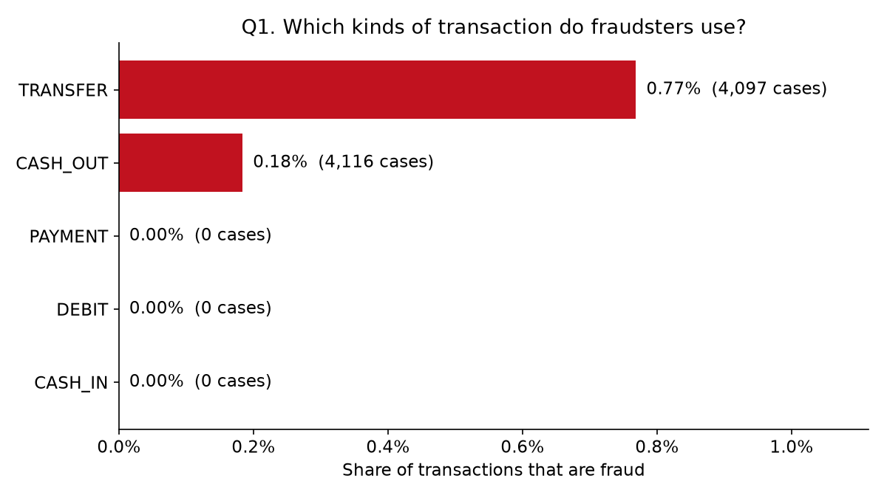
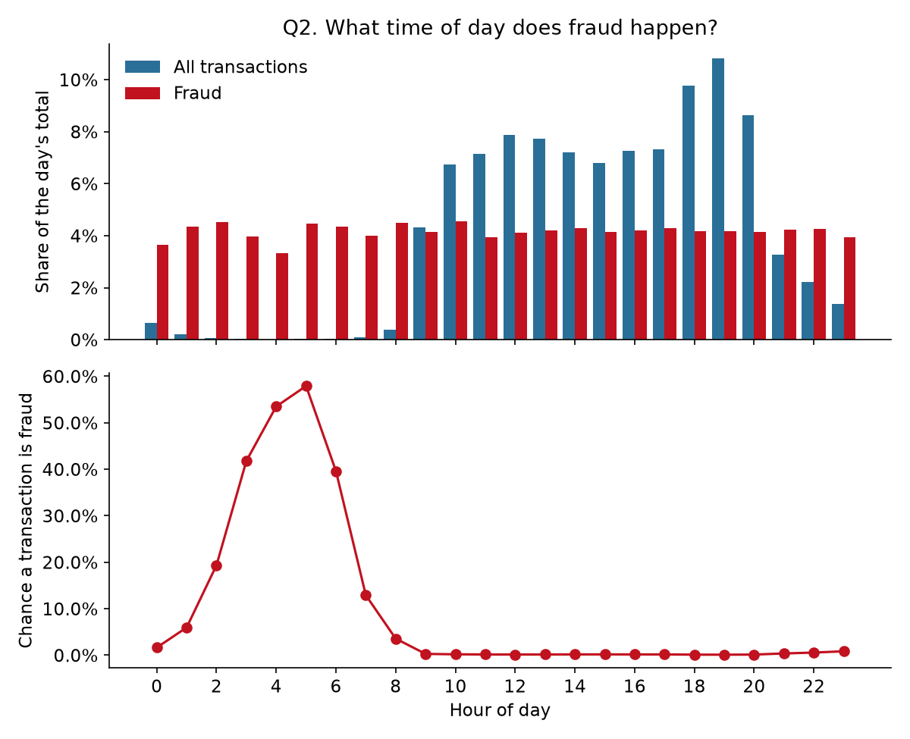
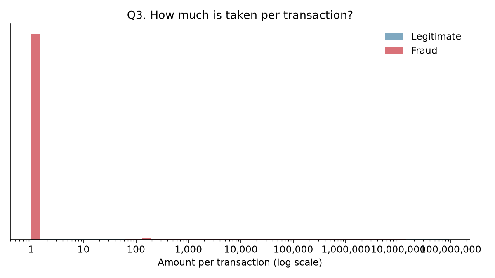
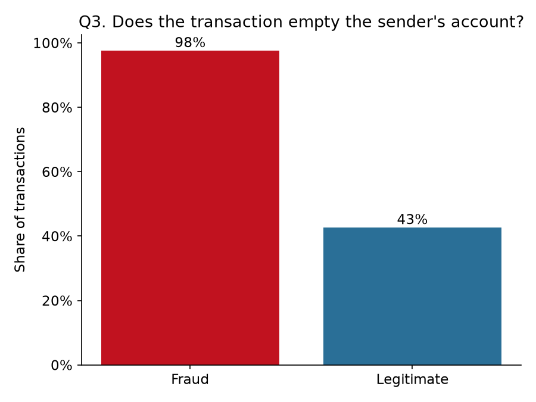
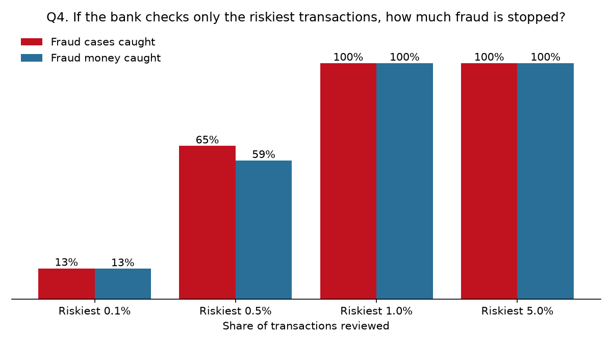

# When Do Scammers Move Money, and How Much Can a Bank Stop?

Data collection, cleaning and analysis of simulated mobile-money transactions (PaySim), in Python.
The fraud in the data follows the mule-account pattern: money is transferred to a receiving account, then cashed out.

**Status:** run on the full dataset (6,362,620 transactions, 8,213 fraud). The data is simulated, so the answers describe the simulation, not real-world or Thai fraud.

## Dashboard
Interactive dashboard with a plain-language explanation of every chart: [`docs/index.html`](docs/index.html).

To publish it with GitHub Pages: repository Settings > Pages > Source "Deploy from a branch" > Branch `main`, folder `/docs`. It is then served at `https://<username>.github.io/<repository>/`. Replace this paragraph with that link once it is live.

## Questions
| # | Question | Answered by | Chart |
|---|---|---|---|
| Q1 | Which kinds of transaction do fraudsters use? | `02_eda.py` | `01_fraud_by_type.png` |
| Q2 | What time of day does fraud happen? | `02_eda.py` | `02_fraud_by_hour.png` |
| Q3 | How much do they take, and do they empty the account? | `02_eda.py` | `03_amount_fraud_vs_legit.png`, `04_account_emptied.png` |
| Q4 | If the bank checks only the riskiest 1% of transactions, how much fraud is stopped? | `03_model.py` | `05_fraud_caught_by_review_budget.png` |

## Answers
**Q1. Only two kinds: transfers and cash-outs.**
All 8,213 fraud cases are TRANSFER (4,097 cases, 0.77% of transfers) or CASH_OUT (4,116 cases, 0.18% of cash-outs). Payments, debits and cash-ins have none. Overall, 0.13% of transactions are fraud.



**Q2. Fraud runs around the clock; normal customers do not.**
Each hour of the day has about the same number of fraud cases (roughly 4% of the total each). Normal activity almost stops between 02:00 and 07:00, so in that window a transfer or cash-out is very likely to be fraud: 58% at 05:00, against 0.1-0.2% between 09:00 and 20:00. Hour of day is `step mod 24`, which assumes the simulation starts at midnight.



**Q3. More than double the normal amount, and almost always the whole balance.**
The median fraud transaction is 441,423 against 171,034 for a legitimate transfer or cash-out (2.6 times). 97.7% of fraud transactions empty the sender's account, against 42.7% of legitimate ones. Total fraud amount over the month is 12.06 billion (currency units of the simulation).




**Q4. Checking the riskiest 1% catches almost all of it, in this simulation.**
On the held-out later period (552,504 transactions, 4,258 fraud), reviewing the 5,525 riskiest transactions catches 99.98% of fraud cases with gradient boosting; 77% of those alerts are real fraud. Reviewing 0.5% catches 65%. The simpler logistic regression catches 68% of cases at 1%, but 97% of the fraud money.



This is far better than a real bank would see. The simulator generates fraud by a simple rule (take the whole balance), which a model learns almost perfectly. Read Q4 as "how the method works", not as an achievable detection rate.

## Where things are
| Item | Location |
|---|---|
| Objective, data source, cleaning rules, methodology, limitations | `docs/METHODOLOGY.md` |
| Source links and licences | `data/reference/sources.csv` |
| Raw data (not committed, download with the script) | `data/raw/` |
| Cleaned data and cleaning log | `data/clean/` |
| Dashboard (single file, built by `04_dashboard.py`) | `docs/index.html` |
| Charts | `output/png/` |
| Result tables | `output/tables/` |
| Scripts | `scripts/` |

## Re-run
From this folder, with Python 3.11+:

```bash
pip install -r requirements.txt
```

```bash
py scripts/00_download.py
```

```bash
py scripts/01_preprocess.py
```

```bash
py scripts/02_eda.py
```

```bash
py scripts/03_model.py
```

```bash
py scripts/04_dashboard.py
```
